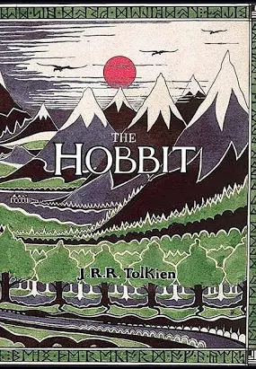

# Objects

**Object-oriented programming (OOP)** is a way of organising a program around objects. An **object** can represent one particular thing the program needs to keep track of.

Imagine a school library with a physical copy of *The Hobbit*.

The program uses an object to keep the details of that book together. For example:

- Title
- Author
- On loan?

{ width="160" }
{: style="text-align: center;" }

